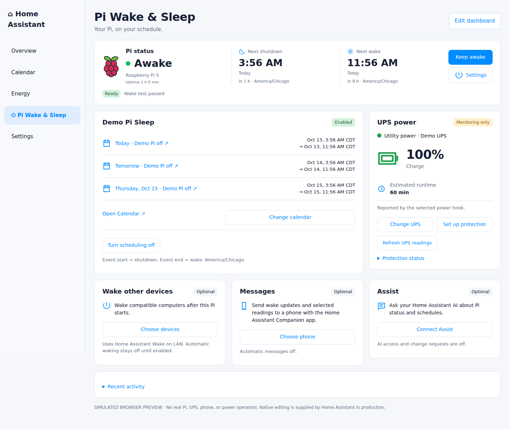

# Pi 5 Wake & Sleep

## Home Assistant, on your schedule.

Wake your Raspberry Pi 5, send useful phone updates, and save power between check-ins. Configure everything through Home Assistant screens, with every date and repeat kept in Home Assistant Calendar.

**Raspberry Pi 5 · Home Assistant OS · 0.10.0 Public Preview · MIT license**

[**Add to Home Assistant**](https://my.home-assistant.io/redirect/supervisor_add_addon_repository/?repository_url=https%3A%2F%2Fgithub.com%2Fcodefendant%2Fpi5-rtc-wake) · [Installation guide](INSTALL.md) · [Updates](UPDATE.md) · [Release notes](RELEASE_NOTES.md) · [Feedback](SUPPORT.md)

<table>
<tr>
<td width="33%"></td>
<td width="33%"></td>
<td width="33%"></td>
</tr>
<tr>
<td valign="top"><strong>Remote check-ins</strong><p>Stay informed from your RV, cabin, or remote setup.</p></td>
<td valign="top"><strong>Battery &amp; solar</strong><p>Reduce power use between monitoring windows.</p></td>
<td valign="top"><strong>Remote access</strong><p>Get notified, keep your Pi awake, and work on your terms.</p></td>
</tr>
</table>

### Fits the Home Assistant you already use

- **Home Assistant Calendar:** one calendar for sleep and wake dates, including repeating times.
- **Network UPS Tools (NUT):** monitor your UPS and configure optional shutdown protection and conditional RTC retries.
- **Messages:** send Pi uptime, next shutdown/wake times, and selected battery, temperature, or other readings to your Companion app phone.
- **Assist:** ask about Pi status and review requested schedule changes through your existing AI integration.
- **Wake other devices:** reuse Home Assistant Wake on LAN buttons when your Pi starts.
- **Your dashboard:** add personal pictures, graphs, and other Home Assistant cards around the Pi cards.

Use **Keep awake** when you need more time, then **Resume shutdowns** when you are ready. Home Assistant pauses while the Pi sleeps. Main power must remain available for RTC wake.



*Example rendered from the app's dashboard cards using sample data and simulated Home Assistant chrome. Your dates, readings, theme, and personal cards will differ.*

The dashboard is the main interface. The add-on Web UI is **Setup & maintenance** for initial connection, repairs, and diagnostics. See [DASHBOARD.md](DASHBOARD.md) for personalization and [VALIDATION.md](VALIDATION.md) for the tested preview's evidence and limits.

## Install and set up

1. Open **Add to Home Assistant**, add the repository, and install **Pi 5 Wake & Sleep** from the app store.
2. Turn off **Protection mode**, enable **Start on boot**, and start the app.
3. Open its Web UI and select **Connect dashboard**. Restart Home Assistant if requested and add the discovered companion in Devices & services. In the new **Pi Wake & Sleep** dashboard, follow **Permissions → Pi checks → Wake test**. Prepare/reboot only if requested, then run and confirm the ten-minute test.
4. Select **Create Pi Sleep calendar**, or choose an existing dedicated calendar. Open Home Assistant Calendar to add dates and repeats: **event start = shutdown; event end = wake**.
5. Review the upcoming list and enable scheduling.

No ZIP download, end-user terminal, API token, YAML automation, or separate card download is needed. If the installation link cannot open Home Assistant, follow the [app-store steps in the installation guide](INSTALL.md#if-the-installation-link-cannot-open-home-assistant). Use **Edit dashboard** to add your own pictures, graphs, and other cards. [INSTALL.md](INSTALL.md) gives the screen-by-screen path. The optional [Wake other devices](WAKE_DEVICES.md) card reuses Home Assistant Wake on LAN buttons, with Ping confirmation, manual waking, and opt-in waking after the Pi boots.

## Everyday use

| Dashboard card | What you do |
|---|---|
| Pi status | See Awake, uptime, next shutdown/wake, and Keep awake / Resume; open Settings for setup, maintenance, or a confirmed reboot. |
| Calendar | Select/create the calendar, review dates, and open native Calendar editing. |
| UPS power | Choose the source, view/enable readings, and configure every protection setting on the card. |
| Wake other devices | Choose and test existing Wake on LAN buttons; optionally confirm devices are online and enable waking after a Pi boot. |
| Messages | Choose a phone/readings, preview drafts, send confirmed status, and enable optional boot messages. |
| Assist | Enable status access, configure reviewed requests, and approve/dismiss them. |
| Pi setup | Review checks and wake-test evidence; completed setup stays compact. |
| Recent activity | Inspect recent actions and optionally restore default Pi cards. |

**Setup & maintenance** is available from Open Web UI and the dashboard's setup area. It holds connection repair and support details. The optional app sidebar shortcut can be hidden on Info once the dashboard works. User-opened details and unsaved forms stay in place during refreshes.

## Calendar scheduling

Home Assistant Calendar is the only schedule store. Use timed events, with **All day** off. For an overnight period, choose the next day as the event end. Off periods must last ten minutes to seven days and must not overlap or touch. The app shows the next ten occurrences within 31 days and refreshes about every 30 seconds.

Before shutdown, the app rechecks the event and verifies an RTC alarm for its exact end. Changed, deleted, unavailable, or stale Calendar data keeps the Pi on. **Keep awake** persistently suspends every app shutdown/reboot, including future Calendar dates and emergency UPS shutdowns, until **Resume shutdowns**. Saved dates and feature choices are kept. Independent controllers remain outside this app’s control. An interrupted countdown is not retried after restart, and firmware or wake-setting changes require a new test.

## UPS monitoring and optional protection

A NUT server communicates with the UPS; Home Assistant's **Network UPS Tools** integration supplies its readings. On **UPS power**, select **Find my UPS**, then **Choose UPS**, choose the source supplying this Pi, and save. Power notices and automatic shutdown protection are opt-in.

**Enable additional NUT readings** activates actual disabled sensors on the selected NUT device. The app explains any reload or Home Assistant restart needed. Device-level disablement is handled on the linked native device page. Auxiliary status such as `OL TEST` is accepted; conflicting status remains Unknown.

Optional protection uses an explicitly selected runtime sensor and reviewed shutdown ownership. Conditional RTC retries are separate from emergency low-battery protection: cancelling a retry or failing an RTC check preserves commissioned emergency protection for the same UPS. Default 15/30/60-minute retries require at least **24/39/69 minutes** of estimated remaining runtime at each decision; a 30-minute threshold normally funds only the first retry at unchanged load.

See [UPS_RECOVERY.md](UPS_RECOVERY.md) for the policy and setup. Developers can publish compatible Home Assistant sensor data using [UPS_HOOKS.md](UPS_HOOKS.md); external executable hooks are not loaded into this privileged app.

## Phone messages

On **Messages**, select **Choose phone**; discovery opens the settings automatically. Choose your Home Assistant Companion app phone, and optionally choose up to twelve existing readings. Every message includes Pi uptime and the next shutdown/wake times, or explains why no time is planned. Preview a draft without sending, save, and use **Send status now** to check your phone. Enable **Send a message after this Pi starts** for the next host boot; app restarts do not duplicate a wake message.

Suggestions use native entity types, device classes, areas, visibility, and the selected NUT UPS. They do not copy the exact dashboard summary order. For today's energy, select an existing daily sensor. Delivery uses the Companion app's existing connection and may use local or Apple/Google push; acceptance by Home Assistant is not a delivery receipt. Phone work is separate from the RTC/UPS worker. See [PHONE_MESSAGES.md](PHONE_MESSAGES.md).

## AI and voice interaction

Requires Core **2026.10 or newer** for the optional native tool platform. After connecting the dashboard, select **Connect Assist** on its card to enable status access. Choose **Assist** under **Control Home Assistant** in your existing AI integration, such as local Ollama. No end-user token, YAML, terminal, or new AI account is needed.

Start with Pi uptime, next shutdown/wake dates, and selected UPS status. Change requests start off. When enabled, dates, scheduling changes, wake tests, and reboots wait for approval in the app. Approved dates go only into Home Assistant Calendar. Cancelling an ordinary current countdown preserves future events and emergency UPS protection. Other household readings use your normal Assist exposed entities. See [ASSIST.md](ASSIST.md).

## Power and firmware

While this Pi is off, Home Assistant and its automations are unavailable. RTC wake needs continuous main input power. An RTC battery keeps time; it cannot boot the Pi. If the UPS switches output off, restart depends on restored output or an independently powered controller.

This app does not switch UPS outputs or implement a complete NUT shutdown handoff. A final emergency stop has no verified timed wake, and utility power returning does not restart a halted Pi whose input stayed powered. Test the actual UPS output-return path before relying on unattended long-outage recovery.

Keep this app's **Protection mode off** during use so it can check the host wake settings and access the built-in RTC. An updated firmware version does not verify or configure low-power wake settings. Home Assistant's Raspberry Pi integration handles board firmware version updates. This app separately checks/prepares `POWER_OFF_ON_HALT=1` and `WAKE_ON_GPIO=0`, preserving boot order and backing up the current settings. Pending updates or unsupported preparation produce an action message. A required reboot appears in Home Assistant Notifications and in Setup.

## Validation and development

The tested baseline passes **418 simulated backend tests**, including persistent Keep awake, saved-policy resume, runtime display, dashboard upgrades, and preservation of customized cards. Release gates additionally cover Chromium desktop/phone interactions, actual Home Assistant Core 2026.10.1 APIs, arm64 builds, anonymous image download, and production imports. The maintainer reports successful repeated fresh installs after removing both the app and dashboard on their Pi 5. [VALIDATION.md](VALIDATION.md) distinguishes automated results from hardware observations. Broader novice, boot-device, and UPS output-return validation remains part of the later stable-release work in [ACCEPTANCE.md](ACCEPTANCE.md).

[VALIDATION.md](VALIDATION.md) separates observed results from remaining checks. [ACCEPTANCE.md](ACCEPTANCE.md) records novice installation/update and physical checks required before removing the preview label. [PUBLICATION.md](PUBLICATION.md) describes the public-release process.

```sh
python3 -m unittest discover -s tests -q
node tests/ui_logic.cjs
```

`python3 tools/preview.py` starts a loopback-only simulated UI and performs no real power operation. Production excludes that preview and the tests.

## License and sources

Distributed under the [MIT License](LICENSE).

[Home Assistant Calendar](https://www.home-assistant.io/integrations/local_calendar/) · [NUT integration](https://www.home-assistant.io/integrations/nut/) · [NUT project](https://networkupstools.org/) · [Pi RTC](https://www.raspberrypi.com/documentation/computers/raspberry-pi.html#real-time-clock-rtc) · [Raspberry Pi integration](https://www.home-assistant.io/integrations/raspberry_pi/)
